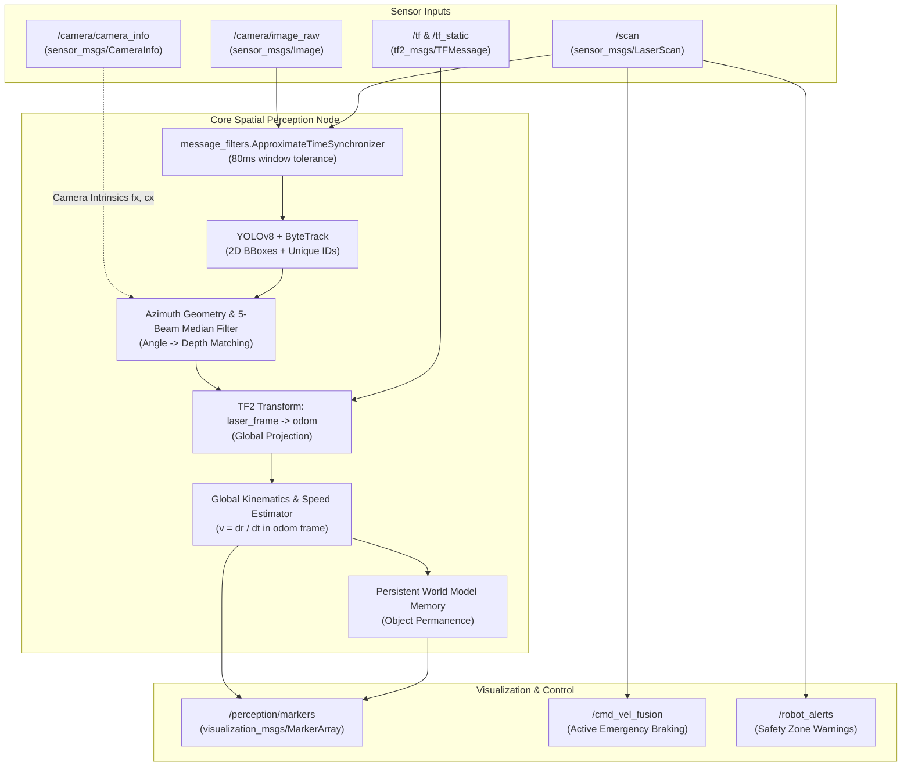

# ROS 2 Spatial Scene Understanding (`r_one`)

[](https://docs.ros.org/en/humble/)
[](https://ubuntu.com/)
[](docker-compose.yml)
[](LICENSE.md)
[](https://www.python.org/)

A real-time 3D spatial perception, multi-target tracking, and persistent world-modeling system for ROS 2 mobile robots.

By fusing **YOLOv8 2D vision** with **2D LiDAR scans**, synchronized via `message_filters` and transformed into a fixed world frame (`odom` / `map`) through **TF2**, `r_one` lets a robot detect objects, track their motion, and remember static ones. World coordinates are only as stable as the odometry or SLAM frame they are expressed in.

> [!WARNING]
> **Not safety-rated.** `r_one` is a research and learning project. Its emergency-braking node is a prototype with known gaps (see the status table) and must not be relied on to stop a real robot. Test in simulation or with the robot lifted off the ground, and keep a hardware e-stop within reach.

## Project Status

This table is the honest state of each feature. Anything not marked **Works** is under active audit and may not behave as the rest of this README describes.

| Feature | Status | Notes |
|---|---|---|
| YOLOv8 + ByteTrack detection, lidar/depth ranging, TF projection to `odom` | Works (simulation) | Camera bearing is used directly as lidar bearing, so close, off-axis objects can be mis-ranged |
| Velocity estimate and `STATIC`/`DYNAMIC` label | Experimental | A target moving slowly relative to the frame rate can be labelled `STATIC`; first sightings are `STATIC` |
| Persistent world model | Experimental | Entries are not yet evicted, so ID churn can grow memory |
| Kalman tracker and occlusion coasting | Experimental | Coasting uses a fixed time step |
| Rosbag playback mode | Experimental | The sample bag download is not published yet, record your own with `scripts/record_sample_bag.sh` |
| Lifecycle (`configure`/`activate`) | Experimental | State transitions work, but the model is loaded and inference runs regardless of state |
| Emergency braking (`sensor_fusion_node`) | **Prototype, unsafe** | Misses most close obstacles, does not fail safe on lidar loss, and is not started by any launch file |
| Alerts (`situational_awareness_node`) | Prototype | Not started by any launch file |
| Nav2 and SLAM configs (`config/`) | Not wired | Written for an older Nav2 release and not launched by any launch file |
| Driving the robot (teleop) | Planned | Controller topics are not yet connected to `/cmd_vel` |
| Real hardware bringup | Planned | `ros2_control` is configured for Gazebo only |

---

## Architecture Pipeline



---

## Key Capabilities

1. **Approximate Time Sensor Synchronization:** Synchronizes `/camera/image_raw` and `/scan` using `message_filters.ApproximateTimeSynchronizer` (slop: 80ms) and applies a 5-beam median filter to eliminate laser noise, dropout rays, and coordinate skew.
2. **Global Coordinates (TF2):** Projects detected objects into the global frame (`odom` or `map`). As the robot drives or rotates, stored static objects in `world_model` stay fixed in that frame (odometry itself drifts over time; use `map` with SLAM to bound it).
3. **True Metric Kinematics & Velocity Projection:** Computes object velocity vectors $(\Delta x / \Delta t, \Delta y / \Delta t)$ in the fixed world frame. Projects future obstacle footprints ($t = 0.5\text{s} \dots 2.0\text{s}$) as a standard `sensor_msgs/msg/PointCloud2` into Nav2's local costmap so autonomous planners proactively route around walking pedestrians.
4. **Interactive 3D RViz2 Displays:** Publishes standard `visualization_msgs/msg/MarkerArray` to `/perception/markers`:
   - **3D Bounding Cubes**: Color-coded green (`STATIC`) and orange (`DYNAMIC`).
   - **Floating HUD Text**: Real-time object class, tracking ID, distance, and metric speed in m/s.
   - **Velocity Vectors & Trajectory Paths**: Directional 3D arrows and lookahead line strips indicating moving target trajectories.
   - **Memory Cylinders**: Visualizes remembered static objects even when outside the camera field of view.
5. **Zero-Simulation Bag Evaluation:** Fully decoupled playback mode allows running and evaluating the entire perception pipeline and RViz visualizer from pre-recorded `.mcap` bags on any laptop without installing Gazebo or spinning up physics simulation.

---

## Quickstart in 60 Seconds

### Option 1: Run with Docker Compose (Zero Setup)

Prerequisites: Install [Docker](https://docs.docker.com/engine/install/) and [Docker Compose](https://docs.docker.com/compose/install/).

```bash
# Allow local container to access X11 graphical display
xhost +local:root

# Clone and launch simulation, spatial perception, and RViz
docker compose up
```

> **Note:** `docker-compose.yml` currently reserves an NVIDIA GPU. On a host without the NVIDIA Container Toolkit, `docker compose up` fails with `could not select device driver "nvidia"`. As a workaround, delete the `deploy:` block in `docker-compose.yml`. A CPU-default compose file is planned.

---

### Option 2: Native ROS 2 Installation

#### 1. System Dependencies
```bash
sudo apt update
sudo apt install -y \
  ros-humble-turtlebot3-gazebo \
  ros-humble-turtlebot3-teleop \
  ros-humble-tf2-geometry-msgs \
  ros-humble-message-filters \
  ros-humble-visualization-msgs \
  ros-humble-vision-msgs \
  ros-humble-diagnostic-msgs \
  ros-humble-ament-cmake-python \
  ros-humble-ros2-control \
  ros-humble-ros2-controllers \
  ros-humble-xacro
```

#### 2. Python Dependencies
> [!IMPORTANT]
> OpenCV and `cv_bridge` in ROS 2 Humble require `numpy<2`. Pin NumPy to version 1.x:
```bash
pip3 install "numpy<2" ultralytics lapx
```

#### 3. Build Workspace
```bash
cd ~/ros2_ws
colcon build --symlink-install --packages-select r_one
source install/setup.bash
```

---

## Running the System

### Single-Command Unified Launch (Recommended)

Starts Gazebo simulation, spawns the robot with differential drive controllers, boots the spatial perception node, and opens RViz2 with pre-configured 3D perception displays:

```bash
ros2 launch r_one spatial_scene.launch.py
```

#### Common Launch Arguments

| Argument | Default | Description | Example |
|---|---|---|---|
| `sim` | `true` | Launch Gazebo simulator and robot spawner | `sim:=false` (runs on physical robot) |
| `rviz` | `true` | Launch RViz2 visualizer | `rviz:=false` (headless mode) |
| `world` | `worlds/spatial_demo.world` | Gazebo world file (features walking human actor) | `world:=worlds/empty.world` |
| `target_frame` | `odom` | Reference frame for world coordinates | `target_frame:=map` (with SLAM/Nav2) |
| `depth_source` | `lidar` | Depth sensor backend: `'lidar'` or `'depth_image'` | `depth_source:=depth_image` |
| `depth_topic` | `camera/depth/image_raw` | Depth image topic when depth_source is depth_image | `depth_topic:=camera/depth/image_raw` |
| `speed_threshold` | `0.15` | Velocity threshold (m/s) for dynamic objects | `speed_threshold:=0.25` |
| `show_camera_window` | `false` | Open separate OpenCV 2D detection window | `show_camera_window:=true` |

*Example: Headless perception on real hardware:*
```bash
ros2 launch r_one spatial_scene.launch.py sim:=false rviz:=false target_frame:=odom
```

---

### Zero-Simulation Evaluation (Rosbag Mode)

Test the 3D perception pipeline instantly without Gazebo or robot hardware:

```bash
# 1. Download sample demonstration bag (or record locally via ./scripts/record_sample_bag.sh)
./scripts/download_sample_bag.sh

# 2. Launch perception and RViz with clock-synchronized bag playback
ros2 launch r_one spatial_bag_playback.launch.py bag_path:=sample_bags/sample_spatial_run.mcap
```

---

### Option B: Individual Node CLI (`ros2 run`)

Nodes can also be executed individually via standard ROS 2 entry points:

```bash
# Spatial 3D Perception & World Model Node
ros2 run r_one spatial_vision_node

# Situational Awareness / Perimeter Warning Node
ros2 run r_one situational_awareness_node

# Active Emergency Braking (AEB) / Sensor Fusion Node
ros2 run r_one sensor_fusion_node

# Mock AI Publisher (for testing without GPU)
ros2 run r_one mock_ai_node
```

#### Legacy Script Compatibility
Direct execution via Python remains fully supported for backward compatibility:
```bash
cd ~/ros2_ws/src/r_one/FakeSceneUnderStanding
python3 spatial_vision_node.py
# or:
python3 real_ai2.py
```

---

## Node Parameters Reference

### `spatial_vision_node`

| Parameter | Type | Default | Dynamic? | Description |
|---|---|---|---|---|
| `target_frame` | `string` | `'odom'` | No | Fixed reference frame for global coordinate transforms and world model |
| `depth_source` | `string` | `'lidar'` | No | Depth sensor source: `'lidar'` (2D scan) or `'depth_image'` (RGB-D pinhole projection) |
| `depth_topic` | `string` | `'camera/depth/image_raw'` | No | Depth image topic when depth_source is depth_image |
| `speed_threshold` | `double` | `0.15` | **Yes** | Minimum speed (m/s) to classify an object as `DYNAMIC` |
| `ema_alpha` | `double` | `0.35` | **Yes** | Exponential Moving Average smoothing factor $\alpha \in (0.0, 1.0]$ for velocity estimation |
| `tracking_filter` | `string` | `'ema'` | **Yes** | Kinematics tracking filter: `'ema'` (velocity smoothing) or `'kalman'` (2D state-space with occlusion coasting) |
| `sync_slop` | `double` | `0.08` | **Yes** | Maximum allowable time delta (seconds) between camera and depth messages |
| `process_every_n_frames` | `int` | `5` | **Yes** | Frame skip rate to minimize CPU/GPU load |
| `show_debug_window` | `bool` | `false` | **Yes** | Displays OpenCV annotated 2D camera window |
| `yolo_model` | `string` | `'yolov8n.pt'` | No | Ultralytics model weights |
| `img_size` | `int` | `320` | No | Input resolution for YOLO inference |
| `autostart` | `bool` | `true` | No | Automatically transitions LifecycleNode to active state on startup |

---

### Dynamic Parameter Reconfiguration

Filter thresholds, frame skip ratios, and smoothing coefficients can be reconfigured live during runtime without restarting the node:

```bash
# Tune velocity classification threshold live (m/s)
ros2 param set /spatial_vision speed_threshold 0.20

# Adjust EMA velocity smoothing factor (0.0 < alpha <= 1.0)
ros2 param set /spatial_vision ema_alpha 0.40

# Adjust inference frequency (every N frames)
ros2 param set /spatial_vision process_every_n_frames 3

# Toggle OpenCV 2D debug window on or off
ros2 param set /spatial_vision show_debug_window true
```

*All dynamic parameter inputs undergo bounds validation and reject invalid or out-of-range values.*

---

### Concurrency & Multi-Threaded Execution

`SpatialVisionNode` is configured with `ReentrantCallbackGroup` and spins under a 4-thread `MultiThreadedExecutor`:
- **Thread 1:** Sensor synchronization and camera image ingestion.
- **Thread 2:** YOLOv8 neural network inference and ByteTrack data association.
- **Thread 3:** TF2 coordinate transformation lookups and pinhole back-projection.
- **Thread 4:** Publisher serialization (`PointCloud2`, `MarkerArray`, `Detection3DArray`, Diagnostics).

> [!NOTE]
> The thread list above describes the intended split. In the current code, frame processing (including inference) runs under a single state lock, so diagnostics and service calls can wait while a frame is being processed. Moving inference out of the lock is planned.

---

### Real-Time Diagnostics & Telemetry (`/diagnostics`)

`SpatialVisionNode` publishes diagnostic telemetry at 1.0 Hz using standard `diagnostic_msgs/msg/DiagnosticArray`:

```bash
ros2 topic echo /diagnostics
```

**Monitored Metrics:**
- `fps`: Rolling perception frame processing rate.
- `latency_ms`: Cycle time per inference and tracking step. Automatically elevates status to `WARN` if latency exceeds 100 ms ($<10$ FPS).
- `active_tracks`: Count of currently tracked entities in ByteTrack memory.
- `world_model_objects`: Count of static spatial entities retained in global coordinates.
- `sync_delta_ms`: Real-time timestamp delta between RGB camera and depth sensor.

---

### Managed Lifecycle Architecture (`LifecycleNode`)

`SpatialVisionNode` is a `rclpy.lifecycle.LifecycleNode`, so it exposes the standard lifecycle services and `ros2 lifecycle` commands.

> [!WARNING]
> **Current limitation:** the lifecycle state is not yet enforced. The YOLO model is loaded when the node is constructed, publishers are ordinary (non-lifecycle) publishers, and frames are still processed while the node is `unconfigured` or after `deactivate`. `on_cleanup` does not unload the model. Making the transitions real (load in `configure`, process only while `active`) is planned.

- `on_activate` / `on_deactivate` / `on_cleanup`: update the reported state and clear some cached markers and world-model data.

> [!TIP]
> **Autostart:** parameter `autostart: true` (default) triggers `configure` and `activate` on boot, so launching `ros2 launch r_one spatial_scene.launch.py` needs no manual lifecycle commands.

```bash
# Query current lifecycle state
ros2 lifecycle get /spatial_vision

# Manual state transitions (when autostart:=false or recovering from faults)
ros2 lifecycle set /spatial_vision configure
ros2 lifecycle set /spatial_vision activate
ros2 lifecycle set /spatial_vision deactivate
ros2 lifecycle set /spatial_vision cleanup
```

---

### Operator Management Services (`std_srvs/srv/Trigger`)

Exposes standard ROS 2 service servers for live memory and tracker management without restarting nodes:

```bash
# 1. Clear static world model and wipe RViz cylinder markers
ros2 service call /spatial_vision/clear_world_model std_srvs/srv/Trigger

# 2. Reset kinematics buffers (note: the ByteTrack state inside the YOLO model is not reset yet)
ros2 service call /spatial_vision/reset_tracker std_srvs/srv/Trigger
```

---

### 2D Constant-Velocity Kalman Filter & Occlusion Coasting

Along with EMA velocity smoothing, `SpatialVisionNode` supports a 2D state-space Kalman Filter ($\mathbf{x} = [x, y, v_x, v_y]^T$):
- **Dynamic Activation:** Switch tracking filter on the fly via `ros2 param set /spatial_vision tracking_filter kalman`.
- **Occlusion Coasting:** When a tracked obstacle (e.g. walking pedestrian) is temporarily occluded behind a narrow pillar for up to 3 frames ($0.24\text{ s}$), the Kalman filter predicts the object's forward trajectory and continues projecting safety footprints into Nav2 dynamic costmaps until detection is regained.

---

### Multi-Robot Scalability & Relative Namespacing

All topics follow REP 103 / REP 105 relative namespace purity (no hardcoded leading `/`). Nodes can be placed inside a robot namespace so their topics do not collide. Multi-robot use is not fully supported yet: TF is published on the global `/tf` and frame names are not prefixed, so frames from two robots would still clash.

```bash
# Run isolated perception pipeline for robot_1
ros2 run r_one spatial_vision_node --ros-args -r __ns:=/robot_1

# Topics resolve cleanly to:
#   /robot_1/camera/image_raw
#   /robot_1/perception/markers
#   /robot_1/perception/detections_3d
#   /robot_1/perception/dynamic_costmap_obstacles
```

---

## ROS 2 Topic & Service Interface

### Topics

| Topic | Type | Direction | QoS Profile | Description |
|---|---|---|---|---|
| `camera/image_raw` | `sensor_msgs/msg/Image` | Subscribed | Best Effort, Volatile, Depth=5 | Raw RGB camera stream |
| `camera/camera_info` | `sensor_msgs/msg/CameraInfo` | Subscribed | Reliable, Volatile, Depth=10 | Optical focal length ($f_x, f_y$) & principal point ($c_x, c_y$) |
| `scan` | `sensor_msgs/msg/LaserScan` | Subscribed | Best Effort, Volatile, Depth=5 | 2D LiDAR range scan (when `depth_source: lidar`) |
| `camera/depth/image_raw` | `sensor_msgs/msg/Image` | Subscribed | Best Effort, Volatile, Depth=5 | Depth image stream (when `depth_source: depth_image`) |
| `/tf`, `/tf_static` | `tf2_msgs/msg/TFMessage` | Subscribed | Dynamic | Dynamic and static coordinate transforms |
| `perception/markers` | `visualization_msgs/msg/MarkerArray` | Published | Reliable, Volatile, Depth=10 | 3D bounding boxes, HUD text, velocity vectors, world model |
| `perception/detections_3d` | `vision_msgs/msg/Detection3DArray` | Published | Reliable, Volatile, Depth=10 | Standard ROS 2 3D detections for Nav2 / autonomous planners |
| `perception/dynamic_costmap_obstacles` | `sensor_msgs/msg/PointCloud2` | Published | Best Effort, Volatile, Depth=5 | Projected future obstacle footprint points for Nav2 dynamic costmap |
| `/diagnostics` | `diagnostic_msgs/msg/DiagnosticArray` | Published | Reliable, Volatile, Depth=10 | System health telemetry (FPS, cycle latency, active tracks) |
| `robot_alerts` | `std_msgs/msg/String` | Published | Reliable, Volatile, Depth=10 | Safety zone warnings (`SAFE_PROCEED`, `CAUTION_SLOW_DOWN`, `HIGH_RISK_STOP`) |
| `cmd_vel_fusion` | `geometry_msgs/msg/Twist` | Published | Reliable, Volatile, Depth=10 | Prototype emergency-braking commands (not consumed by any launch file, see status table) |

### Services

| Service | Type | Description |
|---|---|---|
| `~/clear_world_model` | `std_srvs/srv/Trigger` | Clears all cached static objects from world model memory and wipes RViz visual markers |
| `~/reset_tracker` | `std_srvs/srv/Trigger` | Resets kinematics history and Kalman filter state (ByteTrack IDs are not reset yet) |

---

## Automated Verification Suite

Run the test suite without launching Gazebo:

```bash
colcon test --packages-select r_one && colcon test-result --verbose
```

> [!NOTE]
> The current unit tests exercise copies of the algorithms rather than importing the `r_one` modules, so a passing run does not yet prove the node code is correct. Replacing them is part of the roadmap.

---

## Troubleshooting & FAQ

### 1. `ImportError: numpy.core.multiarray failed to import`
- **Cause:** NumPy 2.x is installed, which is binary incompatible with ROS 2 Humble's `cv_bridge` and system OpenCV.
- **Fix:** Force downgrade to NumPy 1.x:
  ```bash
  pip3 install "numpy<2"
  ```

### 2. RViz / Gazebo Display Error with Docker: `cannot connect to X server`
- **Cause:** Host X11 authorization not granted to the container.
- **Fix:** Run the following command on the host terminal before starting Docker:
  ```bash
  xhost +local:root
  ```

### 3. Object coordinates jumping when the robot moves
- **Cause:** Fixed reference frame is defaulting to a moving frame (e.g. `base_link` or `camera_link`).
- **Fix:** Ensure `target_frame` is set to `'odom'` or `'map'`, and that robot odometry transforms are actively published (`ros2 run tf2_ros tf2_echo odom base_link`).

---

## License

This project is licensed under the Apache 2.0 License. See [LICENSE.md](LICENSE.md) for details.
