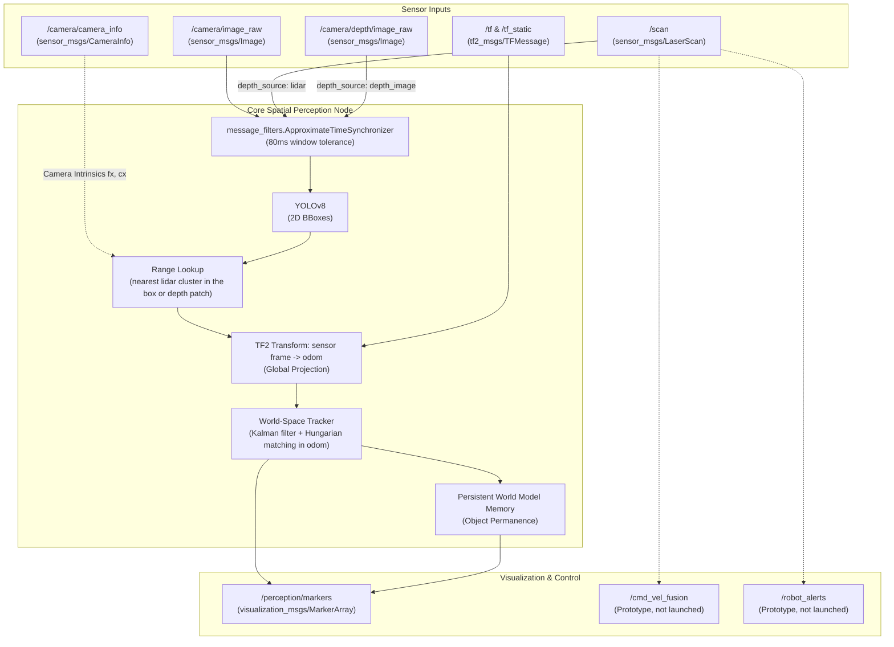

# ROS 2 Spatial Scene Understanding (`r_one`)

[](https://docs.ros.org/en/humble/)
[](https://ubuntu.com/)
[](docker-compose.yml)
[](LICENSE.md)
[](https://www.python.org/)

A real-time 3D spatial perception, multi-target tracking, and persistent world-modeling system for ROS 2 mobile robots.

By fusing **YOLOv8 2D vision** with **2D LiDAR scans** or **depth images**, synchronized via `message_filters` and transformed into a fixed world frame (`odom` / `map`) through **TF2**, `r_one` lets a robot detect objects, track their motion, and remember static ones. World coordinates are only as stable as the odometry or SLAM frame they are expressed in.

> [!WARNING]
> **Not safety-rated.** `r_one` is a research and learning project. Its emergency-braking node is a prototype with known gaps (see the status table) and must not be relied on to stop a real robot. Test in simulation or with the robot lifted off the ground, and keep a hardware e-stop within reach.

## Project Status

This table is the honest state of each feature. Anything not marked **Works** is under active audit and may not behave as the rest of this README describes.

| Feature | Status | Notes |
|---|---|---|
| YOLOv8 detection, lidar/depth ranging, TF projection to `odom` | Works (simulation) | Lidar ranging is tested only on synthetic scans. Gazebo actors have no collisions, so the simulated lidar cannot see the people in the demo and simulation ranges with the depth camera instead |
| Velocity estimate and `STATIC`/`DYNAMIC` label | Experimental | New tracks are `UNKNOWN` until their motion is clear. Tuned on one recorded run and synthetic tests. A target slower than `speed_threshold` is labelled `STATIC` |
| Persistent world model | Experimental | Only proven-static tracks enter it. Capped at 256 entries, least recently seen evicted first. Not yet kept across restarts |
| World-space tracker and occlusion coasting | Experimental | See [World-Space Tracker](#world-space-tracker). Tracks end after 2.5 s without a match |
| Rosbag playback mode | Experimental | Download the sample bag with `r_one/scripts/download_sample_bag.sh`, or record your own with `scripts/record_sample_bag.sh` |
| Lifecycle (`configure`/`activate`) | Experimental | State transitions work, but the model is loaded and inference runs regardless of state |
| Emergency braking (`sensor_fusion_node`) | **Prototype, unsafe** | Misses most close obstacles, does not fail safe on lidar loss, and is not started by any launch file |
| Alerts (`situational_awareness_node`) | Prototype | Not started by any launch file |
| Nav2 and SLAM configs (`r_one_bringup/config/`) | Not wired | Written for an older Nav2 release and not launched by any launch file |
| Driving the robot (teleop) | Planned | Controller topics are not yet connected to `/cmd_vel` |
| Real hardware bringup | Planned | `ros2_control` is configured for Gazebo only. `sim:=false` starts perception alone and is untested on a real robot |

---

## Architecture Pipeline



---

## Key Capabilities

1. **Approximate Time Sensor Synchronization:** Synchronizes `/camera/image_raw` with `/scan` or the depth image using `message_filters.ApproximateTimeSynchronizer` (slop: 80ms). Lidar beams are moved into the camera frame with the static TF and projected into the image. The beams inside a box are split at range jumps over 0.3 m, and the nearest group of at least 2 beams gives the range. Depth ranges use the nearest quartile of a patch over the middle third of the box. The depth image must be the same size as the colour image, and `16UC1` and `mono16` depth is read as millimetres.
2. **Global Coordinates (TF2):** Projects detected objects into the global frame (`odom` or `map`). As the robot drives or rotates, stored static objects in `world_model` stay fixed in that frame (odometry itself drifts over time; use `map` with SLAM to bound it).
3. **True Metric Kinematics & Velocity Projection:** Estimates each object's velocity in the fixed world frame with a Kalman filter. Publishes predicted footprints ($t = 0.5\text{s} \dots 2.0\text{s}$) as a standard `sensor_msgs/msg/PointCloud2`. `config/nav2_params.yaml` lists this topic as a costmap source, but no launch file starts Nav2 yet.
4. **Interactive 3D RViz2 Displays:** Publishes standard `visualization_msgs/msg/MarkerArray` to `/perception/markers`:
   - **3D Bounding Cubes**: Color-coded green (`STATIC`) and orange (`DYNAMIC`). Each cube is sized from the detection box and its range: width = box width × range ÷ $f_x$, height = box height × range ÷ $f_y$, and depth is assumed equal to the width, because the camera cannot see it. The cube is centred on the measured point. When the size is unknown, the cube is 0.45 × 0.45 × 0.50 m.
   - **Floating HUD Text**: Object class, tracking ID, state, and metric speed in m/s.
   - **Velocity Vectors & Trajectory Paths**: Directional 3D arrows and lookahead line strips indicating moving target trajectories.
   - **Memory Cylinders**: Visualizes remembered static objects even when outside the camera field of view.
5. **Zero-Simulation Bag Evaluation:** Fully decoupled playback mode allows running and evaluating the entire perception pipeline and RViz visualizer from pre-recorded MCAP bags on any laptop without installing Gazebo or spinning up physics simulation.

---

## Quickstart

### Option 1: Docker Compose (recommended)

Prerequisites: [Docker](https://docs.docker.com/engine/install/) with the Compose plugin. No GPU is needed.

```bash
git clone https://github.com/orvane-sys/r_one.git
cd r_one

# Allow the container to open windows (Gazebo, RViz) on your X11 display
xhost +local:root

# Build the image and launch simulation, perception and RViz
docker compose up --build
```

The first build downloads the ROS 2 Humble desktop image and the Python dependencies, so expect a large download (several GB) and a wait. Later builds reuse the cache.

| You want | Command |
|---|---|
| NVIDIA GPU inference (needs the [NVIDIA Container Toolkit](https://docs.nvidia.com/datacenter/cloud-native/container-toolkit/latest/install-guide.html)) | `docker compose -f docker-compose.yml -f docker-compose.gpu.yml up --build` |
| Edit the code on the host and see changes without rebuilding | `docker compose -f docker-compose.yml -f docker-compose.dev.yml up` |

The image has the YOLOv8n weights built in, so it starts without network access. The build fails if NumPy, OpenCV, `cv_bridge` and `ultralytics` cannot be imported together.

The image loads [docker/fastdds_profile.xml](docker/fastdds_profile.xml), which enlarges Fast DDS's shared memory so full-size camera images are not dropped ([why](docs/timing_2c.md#image-delivery)). It also keeps ROS traffic on this machine, so nodes on other computers cannot see the container's topics.

---

### Option 2: Native ROS 2 Humble (Ubuntu 22.04)

```bash
# 1. Get the source into a workspace
mkdir -p ~/ros2_ws/src && cd ~/ros2_ws/src
git clone https://github.com/orvane-sys/r_one.git

# 2. Install every ROS dependency declared in the package.xml files
cd ~/ros2_ws
sudo apt update
rosdep install --from-paths src --ignore-src -y --rosdistro humble

# 3. Install the Python dependencies (see requirements.txt for why numpy must be < 2)
pip3 install "torch>=2.2,<2.9" torchvision --index-url https://download.pytorch.org/whl/cpu
pip3 install -r src/r_one/requirements.txt

# 4. Build
colcon build --symlink-install
source install/setup.bash
```

For a GPU, skip the `--index-url` option in step 3 so pip installs the default CUDA wheels.

With the default Fast DDS middleware, the node can miss many camera images. To use the same transport settings as the Docker image, run this in each terminal before launching:
```bash
export FASTRTPS_DEFAULT_PROFILES_FILE=~/ros2_ws/src/r_one/docker/fastdds_profile.xml
```

---

## Running the System

### Single-Command Unified Launch (Recommended)

Starts Gazebo simulation, spawns the robot with differential drive controllers, boots the spatial perception node, and opens RViz2 with pre-configured 3D perception displays:

```bash
ros2 launch r_one_bringup spatial_scene.launch.py
```

#### Common Launch Arguments

| Argument | Default | Description | Example |
|---|---|---|---|
| `sim` | `true` | Launch Gazebo simulator and robot spawner | `sim:=false` (perception only) |
| `gui` | `true` | Open the Gazebo window | `gui:=false` (runs `gzserver`) |
| `publish_robot_tf` | `true` | Start `robot_state_publisher` | `publish_robot_tf:=false` (your robot already runs it) |
| `rviz` | `true` | Launch RViz2 visualizer | `rviz:=false` |
| `world` | `r_one_bringup/worlds/spatial_demo.world` | Gazebo world file (features walking human actor) | `world:=worlds/empty.world` |
| `target_frame` | `odom` | Reference frame for world coordinates | `target_frame:=map` (with SLAM/Nav2) |
| `depth_source` | `depth_image` in simulation, `lidar` with `sim:=false` | Depth sensor backend: `'lidar'` or `'depth_image'` | `depth_source:=lidar` |
| `depth_topic` | `camera/depth/image_raw` | Depth image topic when depth_source is depth_image | `depth_topic:=camera/depth/image_raw` |
| `speed_threshold` | `0.15` | Velocity threshold (m/s) for dynamic objects | `speed_threshold:=0.25` |
| `use_sim_time` | same as `sim` | Use the `/clock` topic | `use_sim_time:=true` |
| `show_camera_window` | `false` | Open separate OpenCV 2D detection window | `show_camera_window:=true` |

*Example: Fully headless simulation:*
```bash
ros2 launch r_one_bringup spatial_scene.launch.py gui:=false rviz:=false
```

*Example: Perception only, on a robot that already publishes its sensors and `odom` transform (not yet tested on real hardware):*
```bash
ros2 launch r_one_bringup spatial_scene.launch.py sim:=false rviz:=false target_frame:=odom
```

---

### Zero-Simulation Evaluation (Rosbag Mode)

Test the 3D perception pipeline instantly without Gazebo or robot hardware:

```bash
# 1. Download sample demonstration bag (or record locally via ./r_one/scripts/record_sample_bag.sh)
./r_one/scripts/download_sample_bag.sh

# 2. Launch perception and RViz with clock-synchronized bag playback
ros2 launch r_one_bringup spatial_bag_playback.launch.py bag_path:=sample_bags/sample_spatial_run
```

---

### Option B: Individual Node CLI (`ros2 run`)

Nodes can also be executed individually via standard ROS 2 entry points:

```bash
# Spatial 3D Perception & World Model Node
ros2 run r_one spatial_vision_node

# Situational Awareness / Perimeter Warning Node
ros2 run r_one situational_awareness_node

# Active Emergency Braking (AEB) / Sensor Fusion Node
ros2 run r_one sensor_fusion_node

# Mock AI Publisher: publishes fake String messages on ai/detections (it does not run YOLO)
ros2 run r_one mock_ai_node
```

---

## Node Parameters Reference

### `spatial_vision_node`

| Parameter | Type | Default | Dynamic? | Description |
|---|---|---|---|---|
| `target_frame` | `string` | `'odom'` | No | Fixed reference frame for global coordinate transforms and world model |
| `depth_source` | `string` | `'lidar'` | No | Depth sensor source: `'lidar'` (2D scan) or `'depth_image'` (RGB-D pinhole projection). The simulation launch file sets `'depth_image'` |
| `depth_topic` | `string` | `'camera/depth/image_raw'` | No | Depth image topic when depth_source is depth_image |
| `speed_threshold` | `double` | `0.15` | **Yes** | Minimum speed (m/s) to classify an object as `DYNAMIC` |
| `sync_slop` | `double` | `0.08` | **Yes** | Maximum allowable time delta (seconds) between camera and depth messages |
| `process_every_n_frames` | `int` | `5` (`2` in the simulation launch file) | **Yes** | Frame skip rate to minimize CPU/GPU load |
| `show_debug_window` | `bool` | `false` | **Yes** | Displays OpenCV annotated 2D camera window |
| `yolo_model` | `string` | `'yolov8n.pt'` | No | Ultralytics model weights |
| `img_size` | `int` | `320` | No | Input resolution for YOLO inference |
| `autostart` | `bool` | `true` | No | Automatically transitions LifecycleNode to active state on startup |

---

### Dynamic Parameter Reconfiguration

The speed threshold, frame skip ratio and sync slop can be reconfigured live during runtime without restarting the node:

```bash
# Tune velocity classification threshold live (m/s)
ros2 param set /spatial_vision speed_threshold 0.20

# Adjust inference frequency (every N frames)
ros2 param set /spatial_vision process_every_n_frames 3

# Toggle OpenCV 2D debug window on or off
ros2 param set /spatial_vision show_debug_window true
```

*All dynamic parameter inputs undergo bounds validation and reject invalid or out-of-range values.*

---

### Concurrency & Multi-Threaded Execution

`SpatialVisionNode` runs its callbacks in one `ReentrantCallbackGroup` under a 4-thread `MultiThreadedExecutor`, and does the heavy work on a worker thread of its own:
- **Executor threads:** sensor and TF callbacks, the diagnostics timer and the services. The sync callback only converts the depth image and hands the frame set to the worker, so none of these wait for inference.
- **Worker thread:** YOLO inference, ranging, TF projection, tracking, publishing and the debug window. It always takes the newest frame set. A frame that a newer one replaces before the worker reaches it is dropped and counted (`dropped_frames` in the run log).
- Tracking, the world model and publishing hold a short state lock, which the diagnostics timer and the services also take.

See [docs/timing_2c.md](docs/timing_2c.md) for the measurements.

---

### Real-Time Diagnostics & Telemetry (`/diagnostics`)

`SpatialVisionNode` publishes diagnostic telemetry at 1.0 Hz using standard `diagnostic_msgs/msg/DiagnosticArray`:

```bash
ros2 topic echo /diagnostics
```

**Monitored Metrics:**
- `throughput_hz`: Frames finished in the last 5 s, divided by 5. It falls to 0 when frames stop.
- `fps`: 1 ÷ average processing time. This is the rate the pipeline could reach, not the rate it is running at.
- `latency_ms`: Cycle time per inference and tracking step.
- `active_tracks`: Live tracks, including unconfirmed ones and ones coasting through an occlusion. Capped at 64.
- `tentative_tracks`, `confirmed_tracks`, `coasting_tracks`: `active_tracks` split by lifecycle state, as on `perception/tracks`.
- `dynamic_tracks`: Live tracks that are `DYNAMIC`.
- `world_model_objects`: Count of static spatial entities retained in global coordinates.
- `sync_delta_ms`: Age of the last processed frame (clock time minus sensor stamp), not the gap between the two sensors.
- `rgb_range_gap_ms`: Gap between the colour image stamp and the depth image or scan stamp of the last processed frame.
- `images_received`, `range_msgs_received`, `dropped_frames`, `tf_failures`: Running totals of images and range messages received, synced frames replaced before the worker took them, and detections dropped because TF had no transform at the image stamp.

The status is `WARN` when latency is over 100 ms, or when `throughput_hz` is under 2 Hz once frames have been arriving for 5 s.

---

### Managed Lifecycle Architecture (`LifecycleNode`)

`SpatialVisionNode` is a `rclpy.lifecycle.LifecycleNode`, so it exposes the standard lifecycle services and `ros2 lifecycle` commands.

> [!WARNING]
> **Current limitation:** the lifecycle state is not yet enforced. The YOLO model is loaded when the node is constructed, publishers are ordinary (non-lifecycle) publishers, and frames are still processed while the node is `unconfigured` or after `deactivate`. `on_cleanup` does not unload the model. Making the transitions real (load in `configure`, process only while `active`) is planned.

- `on_activate` / `on_deactivate`: update the reported state only.
- `on_cleanup`: also clears the world model and track history.

> [!TIP]
> **Autostart:** parameter `autostart: true` (default) triggers `configure` and `activate` on boot, so launching `ros2 launch r_one_bringup spatial_scene.launch.py` needs no manual lifecycle commands.

```bash
# Query current lifecycle state
ros2 lifecycle get /spatial_vision

# Manual state transitions (when autostart:=false or recovering from faults)
ros2 lifecycle set /spatial_vision configure
ros2 lifecycle set /spatial_vision activate
ros2 lifecycle set /spatial_vision deactivate
ros2 lifecycle set /spatial_vision cleanup
```

---

### Operator Management Services (`std_srvs/srv/Trigger`)

Exposes standard ROS 2 service servers for live memory and tracker management without restarting nodes:

```bash
# 1. Clear static world model and wipe RViz cylinder markers
ros2 service call /spatial_vision/clear_world_model std_srvs/srv/Trigger

# 2. Drop every track and restart track IDs from 1
ros2 service call /spatial_vision/reset_tracker std_srvs/srv/Trigger
```

---

### World-Space Tracker

`SpatialVisionNode` tracks objects in `target_frame` with its own tracker ([tracking.py](r_one/r_one/tracking.py)). YOLO runs in plain detection mode (`predict()`), without ByteTrack.
- **Filter:** each track has a constant-velocity Kalman filter ($\mathbf{x} = [x, y, v_x, v_y]^T$) that uses the real time between frames.
- **Matching:** each frame, tracks are matched to the ranged detections of the same class by Mahalanobis distance, using the Hungarian method. A track is published after its second match.
- **Occlusion coasting:** an unmatched track keeps predicting, and its uncertainty grows. A moving track still feeds the costmap while it coasts. A track ends after 2.5 s without a match.
- **Motion:** a track turns `DYNAMIC` once its speed clearly exceeds `speed_threshold`, and `STATIC` after 5 slow matches in a row. Only tracks that are `STATIC` and at least 1 s old enter the world model, and a `DYNAMIC` track leaves it.
- The tuning is fixed in `TrackerConfig`. Only `speed_threshold` is a ROS parameter.

---

### Multi-Robot Scalability & Relative Namespacing

Perception topics use relative names (no leading `/`), so nodes can be placed inside a robot namespace so their topics do not collide. Multi-robot use is not fully supported yet: TF is published on the global `/tf` and frame names are not prefixed, so frames from two robots would still clash.

```bash
# Run isolated perception pipeline for robot_1
ros2 run r_one spatial_vision_node --ros-args -r __ns:=/robot_1

# Topics resolve cleanly to:
#   /robot_1/camera/image_raw
#   /robot_1/perception/markers
#   /robot_1/perception/tracks
#   /robot_1/perception/detections_3d
#   /robot_1/perception/dynamic_costmap_obstacles
```

---

## ROS 2 Topic & Service Interface

### Topics

| Topic | Type | Direction | QoS Profile | Description |
|---|---|---|---|---|
| `camera/image_raw` | `sensor_msgs/msg/Image` | Subscribed | Best Effort, Volatile, Depth=5 | Raw RGB camera stream |
| `camera/camera_info` | `sensor_msgs/msg/CameraInfo` | Subscribed | Reliable, Volatile, Depth=10 | Optical focal length ($f_x, f_y$) & principal point ($c_x, c_y$) |
| `scan` | `sensor_msgs/msg/LaserScan` | Subscribed | Best Effort, Volatile, Depth=5 | 2D LiDAR range scan (when `depth_source: lidar`) |
| `camera/depth/image_raw` | `sensor_msgs/msg/Image` | Subscribed | Best Effort, Volatile, Depth=5 | Depth image stream (when `depth_source: depth_image`) |
| `/tf`, `/tf_static` | `tf2_msgs/msg/TFMessage` | Subscribed | Dynamic | Dynamic and static coordinate transforms |
| `perception/markers` | `visualization_msgs/msg/MarkerArray` | Published | Reliable, Volatile, Depth=10 | 3D bounding boxes, HUD text, velocity vectors, world model |
| `perception/tracks` | `r_one_msgs/msg/TrackArray` | Published | Reliable, Volatile, Depth=10 | Every live track with its state (`TENTATIVE`, `CONFIRMED`, `COASTING`), motion, position, velocity, size and covariance. Empty when nothing is tracked |
| `perception/detections_3d` | `vision_msgs/msg/Detection3DArray` | Published | Reliable, Volatile, Depth=10 | Confirmed tracks matched in this frame, as standard 3D detections. Empty when there are none |
| `perception/dynamic_costmap_obstacles` | `sensor_msgs/msg/PointCloud2` | Published | Best Effort, Volatile, Depth=5 | Predicted footprint points of moving tracks. Empty when nothing moves (see the note below) |
| `/diagnostics` | `diagnostic_msgs/msg/DiagnosticArray` | Published | Reliable, Volatile, Depth=10 | System health telemetry (throughput, latency, track counts) |
| `robot_alerts` | `std_msgs/msg/String` | Published | Reliable, Volatile, Depth=10 | Safety zone warnings (`SAFE_PROCEED`, `CAUTION_SLOW_DOWN`, `HIGH_RISK_STOP`) |
| `cmd_vel_fusion` | `geometry_msgs/msg/Twist` | Published | Reliable, Volatile, Depth=10 | Prototype emergency-braking commands (not consumed by any launch file, see status table) |

> [!NOTE]
> The perception outputs are published on every processed frame, empty when there is nothing to report, so a consumer can drop objects that have gone. Nav2's `ObstacleLayer` does not clear on an empty cloud: it keeps its marks until a clearing source, such as the laser scan, raytraces through them. A costmap layer that repaints from `perception/tracks` is planned. See [docs/outputs_2e.md](docs/outputs_2e.md).

### Services

| Service | Type | Description |
|---|---|---|
| `~/clear_world_model` | `std_srvs/srv/Trigger` | Clears all cached static objects from world model memory and wipes RViz visual markers |
| `~/reset_tracker` | `std_srvs/srv/Trigger` | Drops every track and restarts track IDs from 1. The world model is kept |

---

## Automated Verification Suite

Run the test suite without launching Gazebo:

```bash
colcon test && colcon test-result --verbose
```

> [!NOTE]
> The unit tests import the real `r_one` modules. They cover startup validation, crash guards, launch arguments, the tracker and the scoring tools. They do not yet check detection accuracy or safety behaviour.

### Scoring a Run

`tools/score_run.py` compares a run with the demo world's scripted actor positions. Bag playback writes the run log when you set `run_log_path`:

```bash
mkdir -p reports
ros2 launch r_one_bringup spatial_bag_playback.launch.py \
  rviz:=false loop:=false run_log_path:=$PWD/reports/run.jsonl
# Press Ctrl+C after the bag finishes, then:
python3 tools/score_run.py reports/run.jsonl --gates
```

The scorer needs only Python, and `--gates` exits with an error if any target is missed.

---

## Troubleshooting & FAQ

### 1. `ImportError: numpy.core.multiarray failed to import`
- **Cause:** NumPy 2.x is installed, which is binary incompatible with ROS 2 Humble's `cv_bridge` and system OpenCV.
- **Fix:** Force downgrade to NumPy 1.x:
  ```bash
  pip3 install "numpy<2"
  ```

### 2. RViz / Gazebo Display Error with Docker: `cannot connect to X server`
- **Cause:** Host X11 authorization not granted to the container.
- **Fix:** Run the following command on the host terminal before starting Docker:
  ```bash
  xhost +local:root
  ```

### 3. Object coordinates jumping when the robot moves
- **Cause:** Fixed reference frame is defaulting to a moving frame (e.g. `base_link` or `camera_link`).
- **Fix:** Ensure `target_frame` is set to `'odom'` or `'map'`, and that robot odometry transforms are actively published (`ros2 run tf2_ros tf2_echo odom base_link`).

---

## License

The code in this repository is licensed under the Apache 2.0 License. See [LICENSE.md](LICENSE.md) for details.

> [!IMPORTANT]
> **Ultralytics is AGPL-3.0.** The detector depends on [`ultralytics`](https://github.com/ultralytics/ultralytics) and the Docker image includes `yolov8n.pt`. Neither is covered by this repository's Apache 2.0 licence. Ultralytics [states](https://www.ultralytics.com/license) that using it requires releasing your whole project under AGPL-3.0 or buying an Enterprise licence. Check this before you ship a product built on `r_one`.
